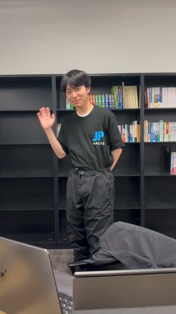
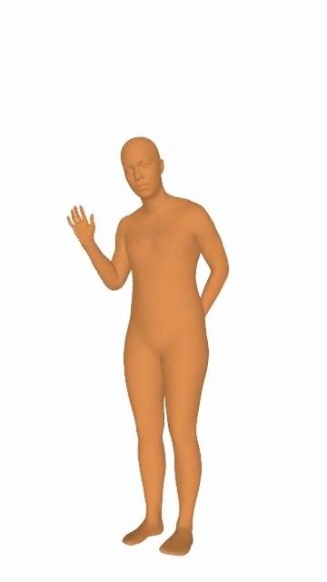
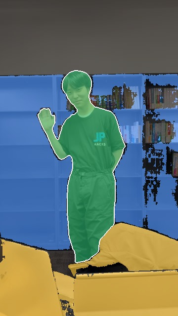
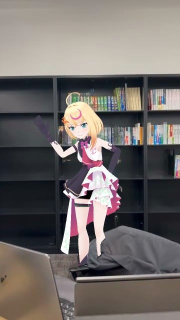

<h1 align="center">
  <picture>
    <source media="(prefers-color-scheme: dark)" srcset="designdocs/brand/color-dark/svg/virtualtwin-logo-horizontal-dark.svg">
    
  </picture>
</h1>

実写動画に映る人物を、**本人の動きのまま VRM アバターに置き換える**ツール。
動画から人物の追跡・3D メッシュ復元・遮蔽（人物の前後関係）の判定・人物除去・VRM 描画・合成までを GPU サーバーで自動化し、
画面（デスクトップアプリ）から取り込み・キャスト（人物へのアバター割り当て）・編集・書き出しを行う。

JPHACKS 2026 のチーム ng_2620 の作品（ロゴとブランドのガイドラインは [designdocs/brand](designdocs/brand/README.md)）。

> **このリポジトリには技術スタックが 2 パターンある**（下の「[技術スタックの 2 つの系統](#技術スタックの-2-つの系統)」）。
> `develop` / `main` は **Tauri 版**（現行）。`refactor/web-first-windows-local-server` は **Tauri を捨ててブラウザ UI + Windows ローカルサーバーにする作り直し**で、
> 計画の段階（チケット [#18](https://github.com/jphacks/ng_2620/issues/18)）。実装はまだ入っていない。

## 製品概要

> デモ動画は準備中です。

### 背景（製品開発のきっかけ）
VTuber はゲーム実況などのリアルタイム配信のイメージが強いが、最近はトラッキング技術で、スタジオでライブ映像を収録したり、
家で全身を動かしながら配信したりできるようになった。

一方で、**外に出て配信・ロケをする**となると、アバターが本当にその場にいるような動画を作るには高度な編集技術が要る。
VTuber の 3D ライブには、お金を払って会場まで足を運ぶファンがいる。ファンは、アバターがまるで現実にいるように感じられることに価値を感じている。
だったら、**推しが現実の街を歩くロケ動画**も見たいはず。それを、編集が得意でない VTuber でも手軽に作れるようにしたい。

既存の手段は、モーションキャプチャ機材と 3D 合成か、1 コマずつの手作業の合成。どちらも重く、特に**人物の手前にある物（机・楽器・通行人）との前後関係**が難所になる
（[PRD](designdocs/PRD.md) §1）。

### 製品説明
撮った動画を入れてアバター（VRM）を選ぶだけで、映っている人物を**本人の動きのまま**アバターに置き換えた動画を作る。
人物を追いかけて体の 3D の動きを推定し、手前にある物と奥にある物を見分けてから、人物を消して背景を埋め、同じ動きのアバターを合成する。

<table>
  <tr>
    <th width="25%">① 人を見つけて追う</th>
    <th width="25%">② 体の 3D の動き</th>
    <th width="25%">③ 前後の判定</th>
    <th width="25%">④ アバターを合成</th>
  </tr>
  <tr>
    <td align="center"></td>
    <td align="center"></td>
    <td align="center"></td>
    <td align="center"></td>
  </tr>
  <tr>
    <td align="center">ViTDet（検出） SAM 3（追跡）</td>
    <td align="center">SAM 3D Body</td>
    <td align="center">黄＝手前・青＝奥 SAM 3（物の切り出し） MoGe-2（奥行き） ＋独自の判定</td>
    <td align="center">LaMa（背景の補完） MediaPipe（表情） VRM の描画</td>
  </tr>
</table>

手前のノート PC は手前のまま残り、アバターはその後ろに立つ。自動の判定が外れた物は、エディタでクリックして「前」「後ろ」を選ぶとその場で直る。

### 既存の方法との比較

| | 処理時間（4 秒の動画） | 料金 | 前後関係 |
|---|---|---|:---:|
| Flow Studio（AI サービス） | 約 38 分 | 合計 15 秒まで無料 | × |
| 生成 AI | — | 高額 | — |
| 公開モデルの組み合わせ（高速化前） | 約 2 分 27 秒 | 無料（ローカル） | ○ |
| **VirtualTwin（最適化後）** | **約 1 分 22 秒** | **無料（ローカル）** | **○** |

公開モデルの組み合わせと VirtualTwin は、3DPW の downtown_bar_00 の 120 フレーム（4 秒）を RTX 5060 Ti で処理し、出力 1080x1920、
追跡から書き出しまでの通しの時間（モデルの読み込みを含む）。

### できること（`develop` の画面）
- 動画の取り込み、解析（人物の追跡）、人物ごとの VRM アバターの割り当て（キャスト）、描画、書き出しの一連の流れ
- 遮蔽（物体が人物の前か後ろか）の自動判定と、**エディタでの手修正**（編集用レイヤーをクライアントで WebGL2 合成する設計で、修正にサーバー往復を要しない）
- GPU が無い機械向けに、同じ API を返す**モックサーバー**

### 入力の制限（既定）
動画は 30 秒以下、長辺 1920px 以下、mp4 / mov。人物（ターゲット）は最大 4 人（[ADR-0011](designdocs/adr/0011-input-limits-and-resolutions.md)、サーバーの環境変数 `VVLOG_MAX_*` で変更可）。

### 目標としている数値（目標であり、実測ではない）
[PRD](designdocs/PRD.md) の成功指標：10 秒・1080p の動画で、取り込みから最初のプレビューまで 2 分以内、置換プレビューまで 8 分以内、前後関係の修正の反映 0.5 秒以内。
推論の速度は RTX 5060 Ti で約 0.72 秒/フレーム（2026-10-24 計測、ADR-0011 に記載）。

### 今後の展望
- Tauri を廃止し、Windows ローカルサーバー + ブラウザ UI にする（下記）
- GitHub Pages で同じ画面を公開し、利用者が自分で用意した GPU サーバーにつないで、手元に CUDA 環境がなくても使えるようにする（機能制限あり）
- 企業向け機能（匿名化、チーム運用、監査）はスコープ外（[ADR-0010](designdocs/adr/0010-out-of-scope-enterprise-and-later.md)）

## 技術スタックの 2 つの系統

| | **現行（`develop` / `main`）** | **作り直し（`refactor/web-first-windows-local-server`、計画段階）** |
|---|---|---|
| 状態 | 実装済み | チケット起票と方針決定のみ。コードは未変更 |
| 画面の入れ物 | **Tauri 2**（Rust）のデスクトップアプリ | **ブラウザ**。UI を持たない Windows アプリが Web サーバーを同梱し、既定ブラウザで操作 |
| 配布の対象 OS | Windows / macOS（Apple Silicon・Intel）のビルドを CI が作る（未署名） | ローカル実行は **Windows（RTX）のみ**。Mac などは Pages 版（制限モード）で外部 GPU に接続 |
| ローカルファイル | Rust 側のコマンドで直接読み書き | ローカルサーバー経由。ファイル選択は Windows のネイティブダイアログ、ドロップはサーバーへ取り込み |
| ローカル推論 | 利用者が指定したフォルダの `.venv` で GPU サーバーを子プロセス起動 | ローカルサーバー自身が推論を呼ぶ。Python・torch・重みは初回起動時に取得（薄いインストーラー + 初回ブートストラップ） |
| 外部 GPU | URL + Bearer トークンで接続（デモは Tailscale） | 同じ。**利用者が自分で GPU サーバーを用意する（BYO）**。運営ホストなし |
| 公開 | GitHub Release にインストーラー | ローカルサーバーが画面も配信。同一ビルドを GitHub Pages にも公開 |
| 対応ブラウザ | （該当なし） | Chrome / Edge と Safari（Mac）を保証。Firefox は保証外 |
| 実装言語 | TypeScript + Rust + Python | TypeScript + Python（Rust は無くなる） |

作り直しの方針は [#18](https://github.com/jphacks/ng_2620/issues/18) と子チケットに残している
（外部 GPU は [#35](https://github.com/jphacks/ng_2620/issues/35)、ダイアログとドロップは [#28](https://github.com/jphacks/ng_2620/issues/28)、Windows での環境自動構築の検証は [#30](https://github.com/jphacks/ng_2620/issues/30)）。
Windows での detectron2 の自動セットアップなど、検証が済んでいない項目がある。確定したら ADR-0015 として `designdocs/adr/` に記録する予定（未作成）。
どちらの系統も、API の契約（`packages/contracts`）は共通に保つ。

## 構成

| 場所 | 中身 |
|---|---|
| `apps/desktop` | 画面（React + TypeScript）。現行では Tauri のネイティブ部分（`src-tauri/`、Rust）も含む |
| `services/gpu_server` | GPU サーバー（FastAPI）。ジョブの受付・アップロード・成果物・進捗（SSE）を担い、推論は `pipeline/` を別プロセスで呼ぶ |
| `services/mock_server` | GPU なしで本物と同じ API・イベント・成果物名を返すモック（中身は `gpu_server` で、ステージだけを再生用に差し替え） |
| `pipeline` | 推論パイプライン（SAM-Body4D 系 + アバター置換）。出どころは [pipeline/UPSTREAM.md](pipeline/UPSTREAM.md) |
| `packages/contracts` | API（OpenAPI）・プロジェクトファイル・遮蔽の手修正の JSON Schema。[CLIENT_GUIDE](packages/contracts/CLIENT_GUIDE.md) |
| `weights` | 重みの取得スクリプトとマニフェスト（重み自体はコミットしない） |
| `designdocs` | PRD・ADR・アーキテクチャ・UX・ブランド。入口は [designdocs/README.md](designdocs/README.md) |
| `docs/slide` | 発表スライド（Marp） |

動かし方は [SETUP.md](SETUP.md)。

## 開発技術

### 活用した技術

#### 画面（`apps/desktop`）
TypeScript ~5.6、React 18、Vite 6、Tailwind CSS 3.4、Radix UI、TanStack Query 5、Zustand 5、react-router-dom 6、react-resizable-panels、lucide-react、fast-png。
合成は WebGL2 を直接使う（`src/presentation/features/editor/compositor/Compositor.ts`）。テストは Vitest 4（jsdom、Testing Library）。
構成は domain / application / infrastructure / presentation の層に分け、OS 機能はポートの裏に置いている（[ADR-0003](designdocs/adr/0003-clean-architecture-and-contract-first.md)）。
なお [ADR-0013](designdocs/adr/0013-frontend-stack.md) に書かれた `openapi-typescript` / `openapi-fetch` / `twgl.js` は `package.json` に入っておらず、現行コードでは使っていない。

#### デスクトップ基盤（現行のみ）
Tauri 2（Rust、edition 2021）。プラグインは http / dialog / notification / opener。ファイル操作、sha256 の計算、ffprobe による動画情報、大容量の分割転送、
GPU サーバーの子プロセス管理を Rust 側のコマンドで行う（`src-tauri/src/commands/` に約 800 行）。作り直しでは、これらをローカルサーバー（Python）に移す計画。

#### GPU サーバー（`services/gpu_server`）
Python 3.11 以上、FastAPI、uvicorn、sse-starlette、pydantic 2、python-multipart、PyYAML、NumPy、Pillow。ffmpeg / ffprobe（動画の検証・変換）が要る。
ジョブは GPU 1 枚につき 1 ワーカーの FIFO で、各ステージをパイプラインのサブプロセスとして実行する（[ADR-0014](designdocs/adr/0014-server-stack.md)）。
通信は HTTP(S) + SSE、認証は `Authorization: Bearer`（[ADR-0012](designdocs/adr/0012-transport-and-auth.md)）。

#### 推論パイプライン（`pipeline`）
Python 3.12 以上、PyTorch（CUDA）。`weights/manifest.json` にある重み：

| モデル | 用途 | ライセンス（マニフェストの記載） |
|---|---|---|
| SAM 3（`facebook/sam3`） | 人物の追跡 | SAM License（Hugging Face で利用許諾が必要） |
| SAM-3D-Body（`facebook/sam-3d-body-dinov3`） | 3D メッシュ復元 | SAM License（同上） |
| MoGe-2（`Ruicheng/moge-2-vitl-normal`） | 深度・法線 | MIT（コード）。モデルカード参照 |
| ViTDet（detectron2） | 人物検出 | Apache-2.0 |
| LaMa（big-lama） | 人物除去（インペイント） | Apache-2.0 |
| MediaPipe Face Landmarker | 表情（`ai-edge-litert` で実行） | Apache-2.0 |

遮蔽の補完には Diffusion-VAS（コードは `pipeline/models/diffusion_vas`、MIT）と Depth Anything V2 を使う（`pipeline/configs/body4d.yaml`）。
そのほか detectron2、pyrender / moderngl（描画）、decord（動画読み込み）、imageio-ffmpeg、diffusers 0.29.1、transformers 4.57 系。
重みは合計約 7GB で、リポジトリには含めず `weights/fetch.py` が取得して sha256 を検証する。

#### API の契約（`packages/contracts`）
OpenAPI（`openapi.yaml`）と JSON Schema（プロジェクトファイル、遮蔽の手修正）。

#### 開発・CI
Node 26、pnpm 10（ワークスペース）、ESLint 9、Prettier、lefthook（pre-push の自動整形）、release-please（CHANGELOG と版管理）、Marp（スライド）。
GitHub Actions は `ci.yml`（prettier / eslint / rustfmt / clippy）、`release.yml`（main への push で Windows x64・macOS arm64/x64 の未署名ビルドを GitHub Release に添付）、
`release-please.yml`、`slide-pdf.yml`。Rust 関連のジョブとファイルは、作り直しで Tauri を削除するときに無くなる予定（[#40](https://github.com/jphacks/ng_2620/issues/40)）。

#### デバイス
- 推論：NVIDIA GPU。Windows の RTX 5060 Ti 機と、Linux の L4 の VM で動作を確認している（[services/gpu_server/README.md](services/gpu_server/README.md)）
- 画面：開発とデモは MacBook（Apple Silicon）。サーバーはチームの Windows GPU 機に Tailscale 越しでつなぐ構成（[ADR-0012](designdocs/adr/0012-transport-and-auth.md)）

### 独自技術

#### 注力したこと：速く、しかも前後関係まで
公開モデルをそのまま組み合わせると時間がかかり、3D 推定の段だけで GPU メモリを 16GB 使うので、手元の GPU（12GB 級）では動かない。
画質を目で確かめながら、処理の形そのものを変えて速くした（計測は実験用リポジトリで、RTX 5060 Ti・120 フレームの動画。採用した改善だけを `pipeline/` に取り込んでいる）。

| 工夫 | 効果 |
|---|---|
| SAM 3 を追跡に必要な部分（トラッカーと画像の特徴抽出）だけで組み、フレームは CPU に置く | 3D 推定の段：GPU メモリ 16.1 → 7.95GB、826 → 90 秒（RTX 4070 SUPER） |
| 前後判定で、物の切り出し（SAM 3）をキーフレームだけで行い、間のフレームは持ち越す | 前後判定：119 → 41 秒（判定のマスクの一致度 0.993） |
| 人物の追跡を 672px と Triton の注意機構で行う | 追跡：42.8 → 14.6 秒 |
| 体の 3D 推定を 3 フレームおきにし、間を補間する | 通し：94.2 → 86.2 秒（目視で差なし） |
| 人物を消した穴を、短い区間ごとに周りのフレームから作った背景で埋める | 通し：89.0 → 82.2 秒（画質は同等） |
| アバターの描画と隠しマスクの計算を並行に走らせる | アバターの段：49.1 → 42.8 秒（出力はバイト単位で一致） |

#### ハッカソンで開発した独自機能・技術
上流の SAM-Body4D（MIT）と、実験用リポジトリの改善（[pipeline/UPSTREAM.md](pipeline/UPSTREAM.md)）が土台。このリポジトリで加えたもの：

- 推論のサービス化：遮蔽判定の保存と遮蔽物ユニット（[pipeline/scripts/occlusion/](pipeline/scripts/occlusion)）、ターゲット指定・VRM 割り当て・手修正の適用・編集用レイヤーの書き出し（[avatar_app.py](pipeline/scripts/avatar_app.py)、[occlusion.py](pipeline/scripts/avatar/occlusion.py)、[layers_export.py](pipeline/scripts/avatar/layers_export.py)）
- GPU サーバー：ジョブキュー、分割アップロード（8MB、再開可）、成果物の Range 配信、SSE による段階的な進捗（[services/gpu_server/vvlog_server/](services/gpu_server/vvlog_server)）
- モックサーバー：実機なしで同じ API を再生（[services/mock_server/](services/mock_server)）
- 画面：取り込みから書き出しまでの流れと、遮蔽の手修正を行うエディタ（[apps/desktop/src/](apps/desktop/src)）

## ライセンス
リポジトリは MIT（[LICENSE](LICENSE)）。`pipeline/models` 配下の SAM 3 / SAM-3D-Body のコードと重みは SAM License で、重みの利用には Hugging Face での許諾が要る。
VRM アバターごとの利用条件は、各アバターのライセンスに従う。
