# VirtualTwin - どこでも最高のアバター映像を。 -

  <picture>
    <source media="(prefers-color-scheme: dark)" srcset="designdocs/brand/color-dark/svg/virtualtwin-logo-horizontal-dark.svg">
    
  </picture>

# 製品概要

**VTuber × 映像 AI**：外で撮った動画に映る人を、**本人の動きのまま** VRM アバターに置き換え、推しが現実の街を歩くロケ動画を手軽に作れるツール。

## 製品開発のきっかけ

VTuber といえば、ゲーム実況や雑談などのリアルタイム配信のイメージが強い。
近年では、技術の進歩により、スタジオでモーションキャプチャをしてライブ映像を収録したり、家でカメラ 1 台で全身を動かしながら配信したりできるようになった。
そして、3D ライブにはお金を払って会場まで足を運ぶファンがいる。ファンは、アバターが**まるで現実にいるように感じられること**に価値を感じている。

だったら、推しが現実の街を歩く**ロケ動画**だって絶対に見たいはず。
ところが、スタジオや家の外に出た途端、アバターがその場にいるような動画を作るハードルは一気に上がる。

### 課題感

<table>
  <tr>
    <td width="33%">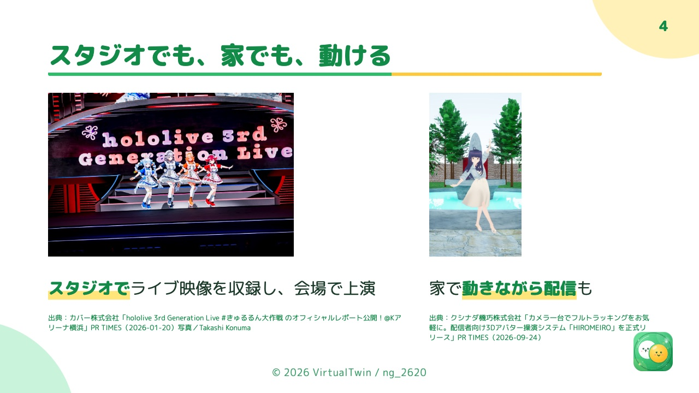</td>
    <td width="33%">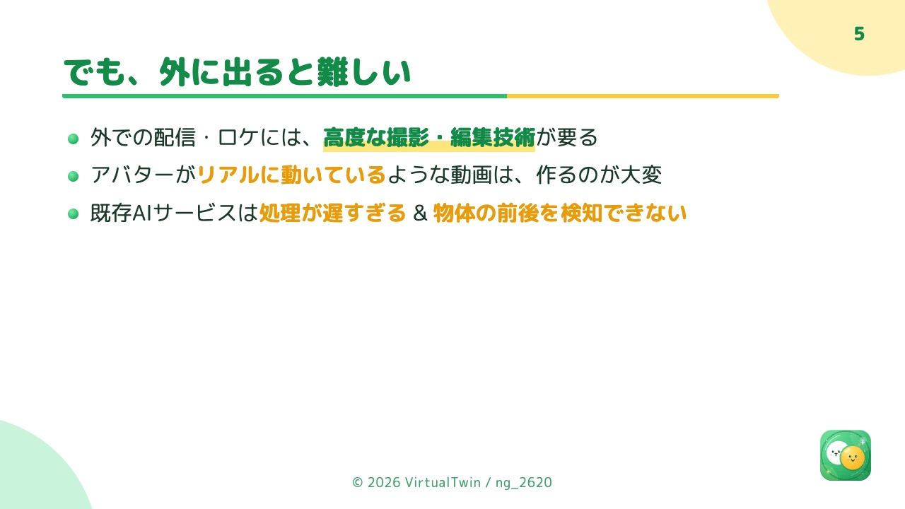</td>
    <td width="33%">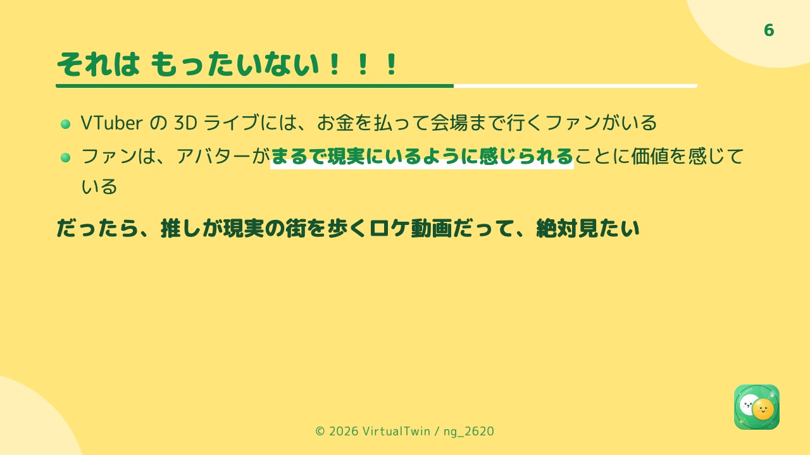</td>
  </tr>
</table>

### 既存の方法の限界

- **手作業の合成**：実写の中にアバターを立たせるには、人を 1 コマずつ切り抜いて消し、背景を埋め、アバターの動きを合わせる必要がある。
  特に、人の手前にある机やバッグ、通行人との**前後関係**は、コマごとの切り抜きでしか表現できず、高度な撮影・編集技術と長い時間が要る。
- **トラッキング配信の仕組み**：スタジオや家のモーションキャプチャは、アバターを仮想空間やリアルタイム配信で動かすためのもの。撮り終えた実写の動画に、その場の物との前後関係ごとアバターを合成する用途には向かない。
- **AI の動画サービス**：既存のサービス（Flow Studio）は 4 秒の動画に約 38 分かかり、しかも手前の物との前後関係を見分けられない。
- **動画生成 AI**：映像を作り直すため費用がかかり（4 秒で約 1 ＄）、イベントや配信の規約によっては生成 AI 自体が使えない場合がある。
- **公開モデルの組み合わせ**：人の追跡や 3D 姿勢推定の研究モデルを組み合わせれば作れるが、3D 推定だけで GPU メモリを 16GB 使い、手元の GPU（12GB 級）では動かない。処理にも時間がかかる。

つまり、**「本人の動きそのまま」「手前の物との前後関係」「手元で速く、無料で」を同時に満たし、編集が得意でない VTuber でも使える手段**がない。

### 解決の方向性

- 映像を生成するのではなく、**人の追跡と 3D 姿勢推定（トラッキング）**で本人の動きを読み取り、そのまま VRM アバターに移す。生成 AI を使えない場面でも使える。
- 手前にある物と奥にある物を自動で見分け、手前の物はアバターの前に残す。判定が外れた物は、画面でクリックしてその場で直せるようにする。
- 研究モデルの処理の形そのものを見直し、手元の GPU で、公開モデルの組み合わせより速く動かす。
- 動画を入れてアバターを選べば、あとは自動で仕上がるようにし、撮影から完成までを 1 つのアプリで完結させる。

## 製品説明

https://github.com/user-attachments/assets/533117e1-965b-4a22-8f6f-0287970d9dfd

会場で撮った動画を、VirtualTwin でロケ動画に仕上げたもの

**VirtualTwin** は、実写の動画に映る人を、本人の動きのままアバターに置き換える**アバター・ロケ動画ジェネレーター**。

- **誰のため？**
  - 外での配信やロケ動画に挑戦したいが、撮影・編集の技術や機材を持たない VTuber
- **何ができる？**
  - スマートフォンで撮った動画を入れてアバター（VRM）を選ぶだけで、映っている人がアバターに置き換わった動画になる
  - 手前にある物（机・バッグ・通行人）は手前に残り、アバターがその場に立っているように見える
  - 複数人が映っていれば、人ごとに別のアバターを割り当てられる
- **どう使える？**
  - 街歩きや旅行先で撮った動画から、アバターのロケ動画や vlog を作る
  - 自動の判定が外れた物は、エディタでクリックして「前」「後ろ」を選ぶと、推論をやり直さずにその場で直る
- **どこが新しい？**
  - 動画生成 AI を使わず、追跡・3D 推定・前後判定の解析モデルだけで、本人の動きをそのまま写す
  - 公開モデルの組み合わせを最適化し、手元の GPU で既存の AI サービスより大幅に速く、前後関係まで正しく仕上げる

### 内部推論モデルがやっていること

処理は 4 段階。人を見つけて最後まで追いかけ、体の 3D の動きを推定し、手前にある物と奥にある物を見分けてから、人を消して背景を埋め、同じ動きのアバターを合成する。
操作はすべてブラウザで行い、重い推論は GPU 機が担う。

**使い方**：① 動画を取り込む（ファイル選択かドロップ） → ② 映っている人を解析して追跡 → ③ 人ごとに VRM アバターを割り当て → ④ 描画 → ⑤ エディタで前後関係を手直し → ⑥ MP4 で書き出し。
「既定のアバターで自動仕上げ」を選んでおけば、①の後は④まで自動で進む。

| 使い方 | 環境 |
|---|---|
| GPU 機で使う | Windows + NVIDIA GPU（GPU メモリ 12GB 級以上。RTX 5060 Ti で確認）にインストーラーで入れ、ブラウザで操作する |
| GPU が無い | GitHub Pages の画面（Chrome / Edge / Safari）から、自分で用意した GPU サーバー（クラウドの GPU など。Docker イメージあり）につなぐ。機能は一部制限される |

<table>
  <tr>
    <th width="25%">① 人を見つけて追う</th>
    <th width="25%">② 体の 3D の動き</th>
    <th width="25%">③ 前後の判定</th>
    <th width="25%">④ アバターを合成</th>
  </tr>
  <tr>
    <td align="center"></td>
    <td align="center"></td>
    <td align="center"></td>
    <td align="center"></td>
  </tr>
  <tr>
    <td align="center">ViTDet（検出） SAM 3（追跡）</td>
    <td align="center">SAM 3D Body MoGe-2（カメラの画角）</td>
    <td align="center">黄＝手前・青＝奥 SAM 3（物の切り出し） Depth Anything V2（奥行き） ＋独自の判定</td>
    <td align="center">LaMa（背景の補完） MediaPipe（表情） VRM の描画</td>
  </tr>
</table>

## 特長

### 1. 速く・安く・前後関係まで

| | 処理時間（4 秒の動画） | 料金 | 前後関係 |
|---|---|---|:---:|
| Flow Studio（AI サービス） | 約 38 分 | 合計 15 秒まで無料 | × |
| 生成 AI | 約 2 分 | 約 1 ＄ | ○ |
| 公開モデルの組み合わせ（高速化前） |  2 分 27 秒 | 無料（ローカル） | △ |
| **VirtualTwin（最適化後）** | **1 分 22 秒** | **無料（ローカル）** | **○** |

公開モデルの組み合わせと VirtualTwin は、3DPW（von Marcard et al., ECCV 2018）の downtown_bar_00 の 120 フレーム（4 秒）を RTX 5060 Ti で処理し、出力 1080x1920、
追跡から書き出しまでの通しの時間（モデルの読み込みを含む）。
VirtualTwin は動画生成 AI を使わず、追跡・3D 推定・前後判定などの解析モデルだけで完結する（人を消した背景の穴埋めは、周りのフレームと LaMa による補完）。
そのため、ハッカソンやイベント、配信先の規定で生成 AI が使えない場面でも使える。

下は、手元の GPU 機（RTX 5060 Ti）で、2 秒のサンプル動画（480x854）を取り込んでから、解析・描画を経てエディタで再生するまでを、早送りせずに録画したもの。

https://github.com/user-attachments/assets/e8549836-48a8-487c-8e17-4c37e804d527

### 2. 自動の判定が外れても、その場で直せる

エディタで物をクリックして「前」「後ろ」を選ぶだけ。合成はアプリ側でやり直すので、推論をやり直さずにその場で反映される（下は、手前のバッグを切り替えて足が隠れる・出るを確かめている）。

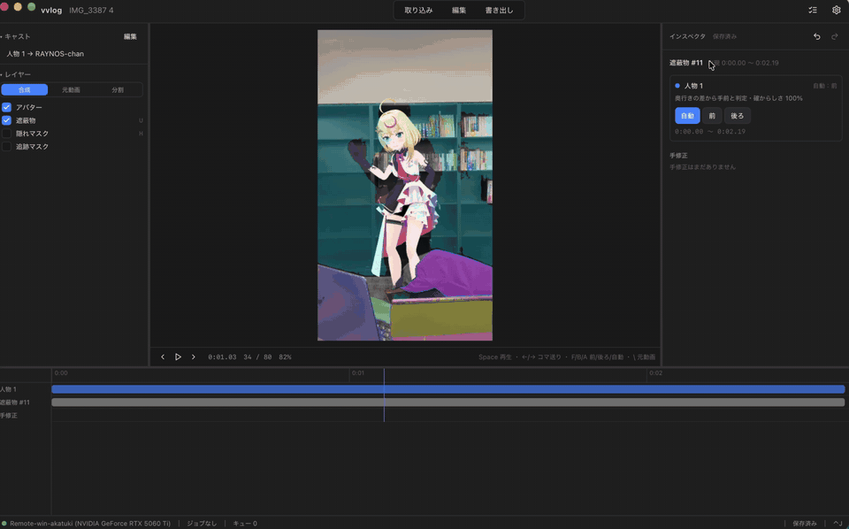

### 解決出来ること

- 撮影・編集の技術がない VTuber でも、外で撮った動画からアバターのロケ動画を作れる
- 人の手前にある物との前後関係が正しいので、アバターがその場にいるように見える
- 手元の GPU（12GB 級）で動き、料金がかからない

### 今後の展望

- 精度向上：物を持っていても置き換えられるようにする、人の除去を確実にする
- 補正・編集しやすい形で出力する
- *顔は見せたくないけどロケ動画を作りたい*人にも届ける
- Windows 以外の機械でのローカル実行と、インストーラーのコード署名

### 注力したこと（こだわり等）

公開モデルをそのまま組み合わせると時間がかかり、3D 推定の段だけで GPU メモリを 16GB 使うので、手元の GPU（12GB 級）では動かない。
画質を目で確かめながら、処理の形そのものを変えて速くした（RTX 5060 Ti・120 フレームの動画で計測）。

| 工夫 | 効果 |
|---|---|
| SAM 3 を追跡に必要な部分（トラッカーと画像の特徴抽出）だけで組み、フレームは CPU に置く | 3D 推定の段：GPU メモリ 16.1 → 7.95GB、826 → 90 秒（RTX 4070 SUPER） |
| 前後判定で、物の切り出し（SAM 3）をキーフレームだけで行い、間のフレームは持ち越す | 前後判定：119 → 41 秒（判定のマスクの一致度 0.993） |
| 人物の追跡を 672px と Triton の注意機構で行う | 追跡：42.8 → 14.6 秒 |
| 体の 3D 推定を 3 フレームおきにし、間を補間する | 通し：94.2 → 86.2 秒（目視で差なし） |
| 人物を消した穴を、短い区間ごとに周りのフレームから作った背景で埋める | 通し：89.0 → 82.2 秒（画質は同等） |
| アバターの描画と隠しマスクの計算を並行に走らせる | アバターの段：49.1 → 42.8 秒（出力はバイト単位で一致） |

### 発表スライド

[docs/slide/pitch.md](docs/slide/pitch.md)（Marp）。PDF は [Releases](https://github.com/jphacks/ng_2620/releases) の `slide-*`。

<table>
  <tr>
    <td width="33%">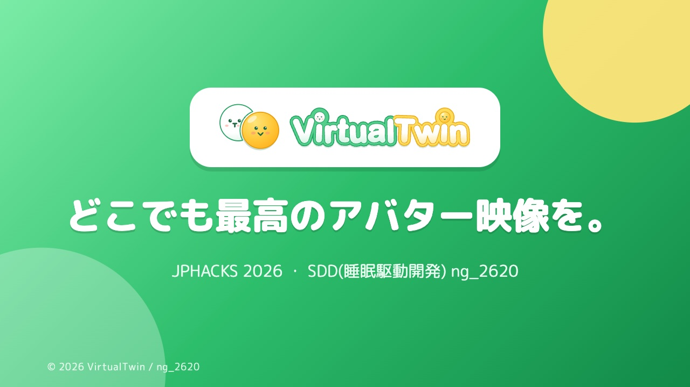</td>
    <td width="33%"></td>
    <td width="33%">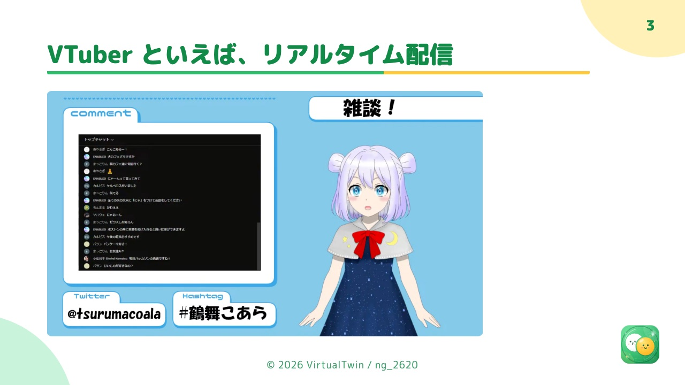</td>
  </tr>
  <tr>
    <td></td>
    <td></td>
    <td></td>
  </tr>
  <tr>
    <td>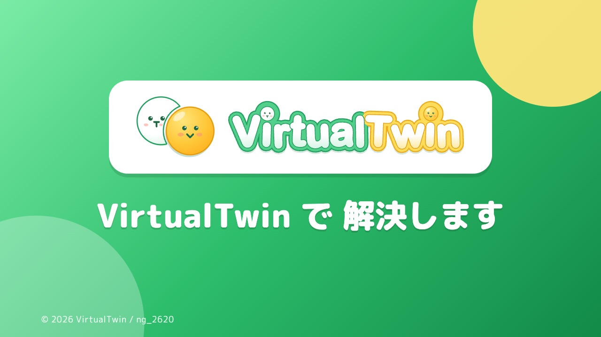</td>
    <td>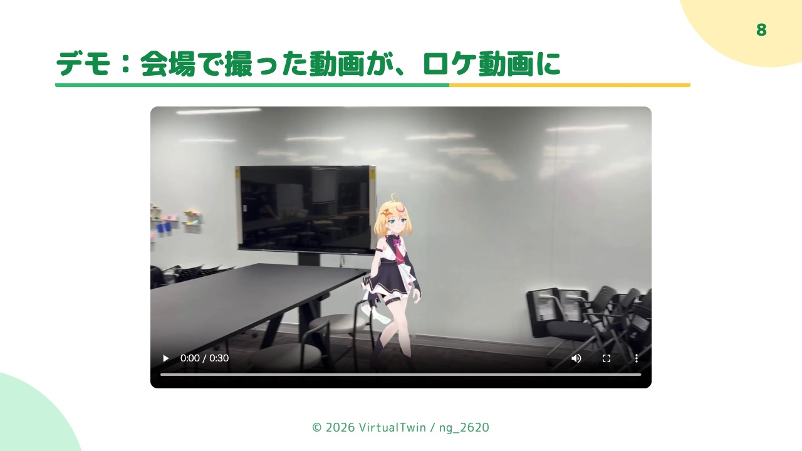</td>
    <td>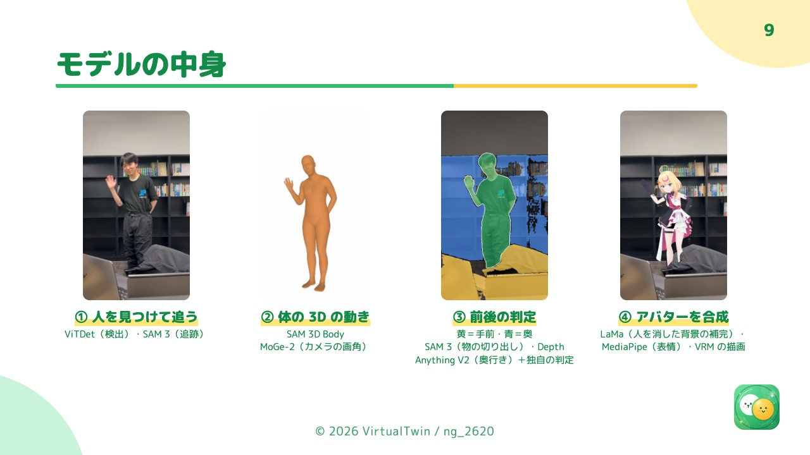</td>
  </tr>
  <tr>
    <td>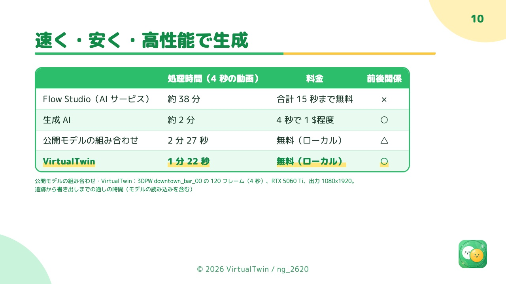</td>
    <td>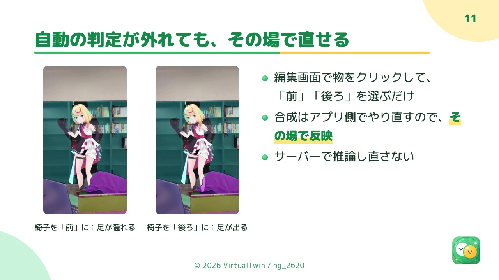</td>
    <td>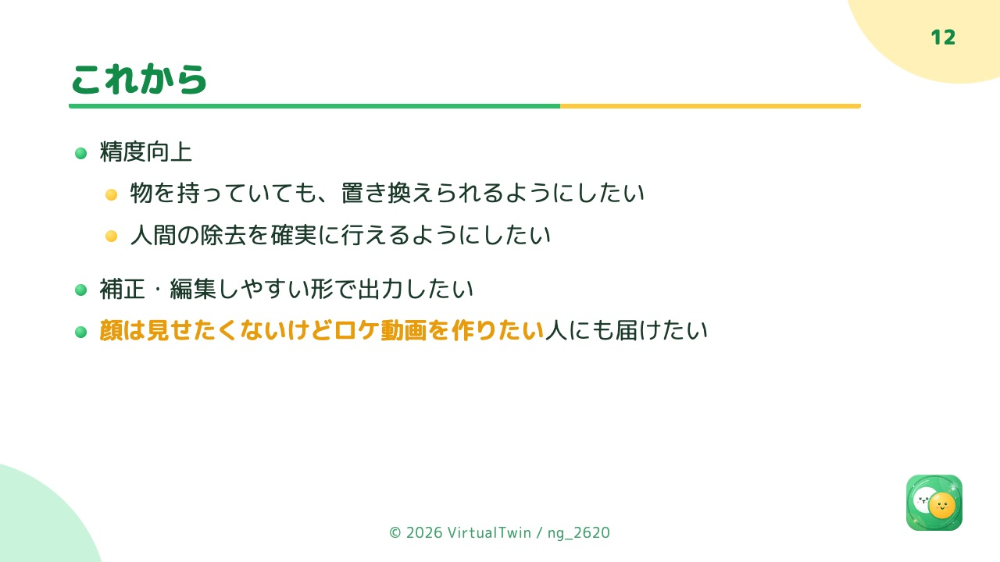</td>
  </tr>
  <tr>
    <td></td>
    <td></td>
    <td></td>
  </tr>
</table>

## 開発技術

### 活用した技術

#### API・データ

* 推論モデル：SAM 3、SAM 3D Body、MoGe-2、Depth Anything V2 Metric Indoor Small、ViTDet（detectron2）、LaMa、MediaPipe Face Landmarker
* 計測用データ：[3DPW](https://virtualhumans.mpi-inf.mpg.de/3DPW/)（非商用の学術研究に限る。リポジトリには含めない）

#### フレームワーク・ライブラリ・モジュール

* 画面（ブラウザ）：React 18 + TypeScript、Vite、Tailwind CSS、Radix UI、Zustand、TanStack Query、WebGL2（エディタでの合成）、Playwright（E2E）
* GPU サーバー：FastAPI、uvicorn、SSE（進捗の配信）、ffmpeg
* ローカルアプリ（Windows）：画面を持たないランチャー + ローカルサーバー、Inno Setup（インストーラー）、uv（初回の環境構築）、pystray（トレイアイコン）
* 外部 GPU：CUDA 対応の Docker イメージ
* 推論パイプライン：PyTorch（CUDA）、Triton、detectron2、pyrender / moderngl（VRM の描画）、OpenCV
* 発表：Marp

#### デバイス

* 推論：NVIDIA GPU（RTX 5060 Ti の Windows 機、L4 の Linux VM で動作を確認）
* 画面：Windows のローカルアプリ、または Chrome / Edge / Safari で開く GitHub Pages。デモでは MacBook（Apple Silicon）のブラウザから Windows の GPU 機に Tailscale 越しでつなぐ

### 独自技術

#### ハッカソンで開発した独自機能・技術

土台は上流の SAM-Body4D（MIT）。ハッカソンの期間中に開発したもの：

* 推論パイプラインの高速化と画質の改善（上の「注力したこと」）。人物除去（背景の補完）、表情、アバターの大きさと配置、前後判定の改善も行った。取り込みの記録は [pipeline/UPSTREAM.md](pipeline/UPSTREAM.md)
* 推論のサービス化：遮蔽判定の保存と遮蔽物ユニット（[pipeline/scripts/occlusion/](pipeline/scripts/occlusion)）、ターゲット指定・VRM 割り当て・手修正の適用・編集用レイヤーの書き出し（[avatar_app.py](pipeline/scripts/avatar_app.py)、[occlusion.py](pipeline/scripts/avatar/occlusion.py)、[layers_export.py](pipeline/scripts/avatar/layers_export.py)）
* GPU サーバー：ジョブキュー、分割アップロード（8MB、再開可）、成果物の Range 配信、SSE による段階的な進捗（[services/gpu_server/vvlog_server/](services/gpu_server/vvlog_server)）
* 画面：取り込みから書き出しまでの流れ、遮蔽の手修正を WebGL2 で即時に合成するエディタ（[compositor/](apps/desktop/src/presentation/features/editor/compositor)）、既定のアバターでの自動仕上げ（[autoFinishStore.ts](apps/desktop/src/presentation/shared/stores/autoFinishStore.ts)）
* Web 化：ローカルアプリサーバー（ランチャー、ネイティブダイアログ、ファイル API、初回の環境構築、重みの取得）と、Pages 向けの制限モード・外部 GPU への接続（[services/gpu_server/vvlog_server/](services/gpu_server/vvlog_server)、[installer/](installer)）

## ライセンス

コードは MIT（[LICENSE](LICENSE)）。モデルの重みは SAM License（SAM 3・SAM 3D Body）、MIT、Apache-2.0 などで、ViTDet の重みのライセンスは公式の記載がなく未確定。
モデル・ライブラリ・データごとの詳細は [docs/LICENSES.md](docs/LICENSES.md)。

---

動かし方は [SETUP.md](SETUP.md)、設計資料は [designdocs/](designdocs/README.md)。
