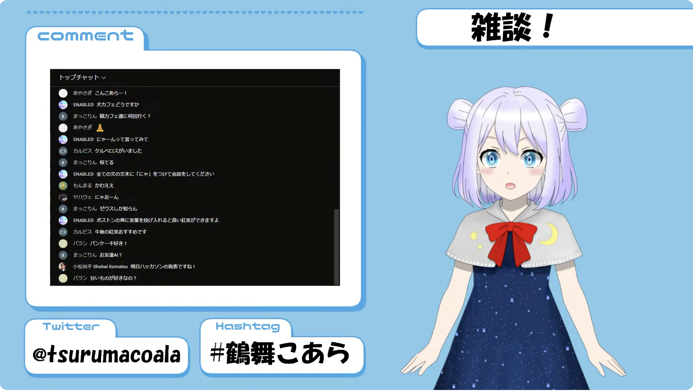
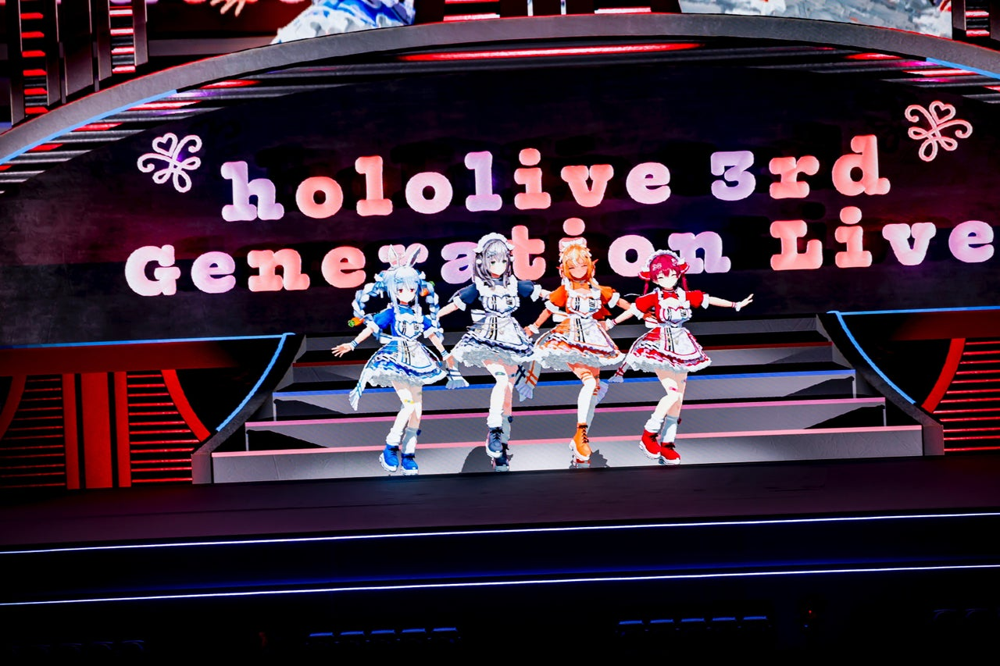
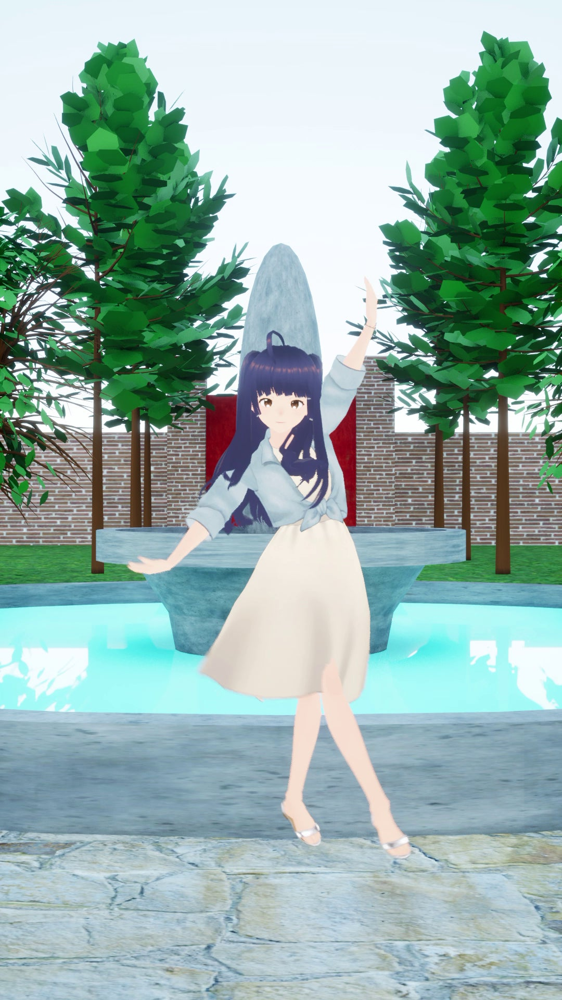

<!-- _class: lead -->
<!-- _paginate: false -->

# どこでも最高のアバター映像を。

JPHACKS 2026 ・ SDD(睡眠駆動開発) ng_2620

<!--
（0 ページ目：タイトル）
始める前に、アプリで「既定のアバターで自動仕上げ」に会場で撮った動画を入れておく。
-->

---

<!-- _class: lead -->
<!-- _paginate: false -->

# VTuber って 知ってる？

<!--
（1 ページ目）前置き：VTuber って知ってる？
-->

---

## VTuber といえば、リアルタイム配信

<!--
（2 ページ目）アバターがゲーム実況などリアルタイム配信してるイメージが強いかもですが、
-->

---

<!-- _class: cols -->

## スタジオでも、家でも、動ける

**スタジオで**ライブ映像を収録し、会場で上演

出典：カバー株式会社「hololive 3rd Generation Live #きゅるるん大作戦 のオフィシャルレポート公開！@Kアリーナ横浜」PR TIMES（2026-01-20）写真／Takashi Konuma

家で**動きながら配信**も

出典：クシナダ機巧株式会社「カメラ一台でフルトラッキングをお気軽に。配信者向け3Dアバター操演システム「HIROMEIRO」を正式リリース」PR TIMES（2026-09-24）

<!--
（3 ページ目）実はトラッキング技術を使ってスタジオでライブ映像を収録したり、家で動きながら配信が最近できるようになってるよ
-->

---

## でも、外に出ると難しい

- 外での配信・ロケには、**高度な撮影・編集技術**が要る
- アバターが*リアルに動いている*ような動画は、作るのが大変
- 既存AIサービスは*処理が遅すぎる* & *物体の前後を検知できない*

<!--
（4 ページ目）でも、外で配信、ロケをするとなったら高度な編集技術が必要で、アバターがリアルに動いているような動画を作るのは難しい
-->

---

<!-- _class: accent -->

## それは もったいない！！！

- VTuber の 3D ライブには、お金を払って会場まで行くファンがいる
- ファンは、アバターが**まるで現実にいるように感じられる**ことに価値を感じている

### だったら、推しが現実の街を歩くロケ動画だって、絶対見たい

<!--
（5 ページ目）それは勿体無いよ。
近年 VTuber の 3D ライブに、わざわざお金を払って会場まで行く人がいて、
ファンは、アバターがまるで現実にいるように感じられることに価値を感じてるんだと思う。

（5 ページ目のまま）だったら、推しが現実の街を歩くロケ動画だって絶対見たいはず！
もし、これが手軽に作れたら、編集が得意じゃない VTuber でも気軽にロケ動画に挑戦できるのにな〜〜〜〜〜
-->

---

<!-- _class: lead -->
<!-- _paginate: false -->

# VirtualTwin で 解決します

<!--
（6 ページ目）これ、バーチャルツインの AI モデルで解決します
-->

---

<!-- _class: nologo -->

## デモ：会場で撮った動画が、ロケ動画に

（ここに会場で撮った動画と、30 秒くらいの vlog を流す）

<!--
（7 ページ目）デモ：会場で撮った使用動画と 30 秒くらいの vlog を見せる。

（7 ページ目のまま）このように、AI の位置推定を活用して、既存のサービスより高品質に、編集より早く作れるよ
-->

---

## モデルの中身

**① 人を見つけて追う**

ViTDet（検出）・SAM 3（追跡）

**② 体の 3D の動き**

SAM 3D Body

**③ 前後の判定**

黄＝手前・青＝奥 SAM 3（物の切り出し）・MoGe-2（奥行き）＋独自の判定

**④ アバターを合成**

LaMa（人を消した背景の補完）・MediaPipe（表情）・VRM の描画

<!--
（8 ページ目）実現のために使った技術はこれです。
動画の中の人を見つけて最後まで追いかけ、体の 3D の動きを推定し、手前にある物と奥にある物を見分けてから、人を消して同じ動きのアバターを合成しています。
-->

---

## 速く・安く・高性能で生成

| | 処理時間（4 秒の動画） | 料金 | 前後関係 |
|---|---|---|:---:|
| Flow Studio（AI サービス） | 約 38 分 | 合計 15 秒まで無料 | × |
| 生成 AI | 約 2 分 | 4 秒で 1 $程度 | ○ |
| 公開モデルの組み合わせ | 2 分 27 秒 | 無料（ローカル） | △ |
| **VirtualTwin** | **1 分 22 秒** | **無料（ローカル）** | **○** |

公開モデルの組み合わせ・VirtualTwin：3DPW downtown_bar_00 の 120 フレーム（4 秒）、RTX 5060 Ti、出力 1080x1920。 追跡から書き出しまでの通しの時間（モデルの読み込みを含む）

<!--
（8 ページ目の続き）そして、モデルの最適化を同時に頑張りました。
競合の Flow Studio は 4 秒の動画に 38 分かかり、手前の物との前後関係も見分けられません。
私たちは、公開モデルを組み合わせた版から最適化を重ねて、同じ 4 秒の動画を約 1 分 20 秒で、前後関係まで正しく仕上げます。

数字の出どころ（vlog_JPHack2026 の image_analytics、scripts/eval/e2e.py の計測）：
- 高速化前 146.8 秒：9d1d7a9 のコミットメッセージ（その直前の状態での downtown_bar の E2E）
- 最適化後 82.2 秒：b9301a8 のコミットメッセージ、reports/compare/README.md
-->

---

## これから

- 精度向上
  - 物を持っていても、置き換えられるようにしたい
  - 人間の除去を確実に行えるようにしたい
- 補正・編集しやすい形で出力したい
- *顔は見せたくないけどロケ動画を作りたい*人にも届けたい

<!--
（9 ページ目）今後の展望としては、
物持ってても置換に対応したい！ 編集しやすい出力にしたい！
顔を見せたくないけどロケ動画を作りたい層にもウケそうなので展開したい！ と思ってるよ
-->

---

<!-- _class: lead -->
<!-- _paginate: false -->

# どこでも最高のアバター映像を。

<!--
（10 ページ目）以上、バーチャルツインでした、ありがとうだよ
-->
